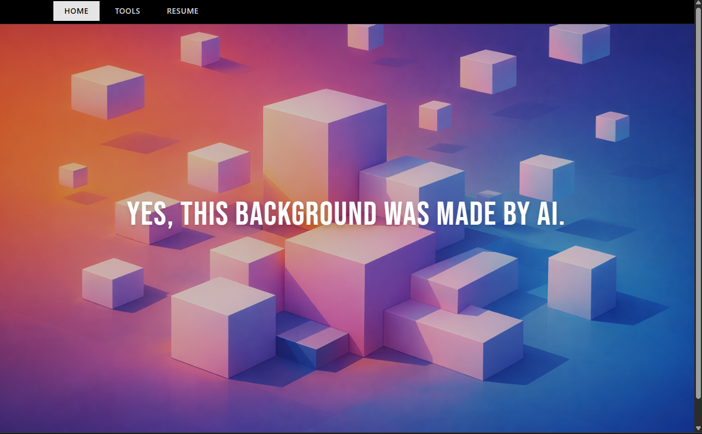
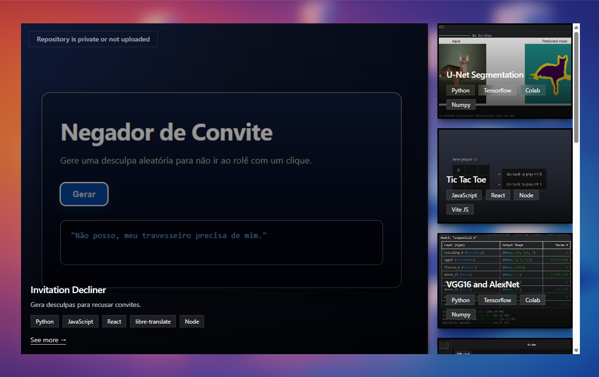
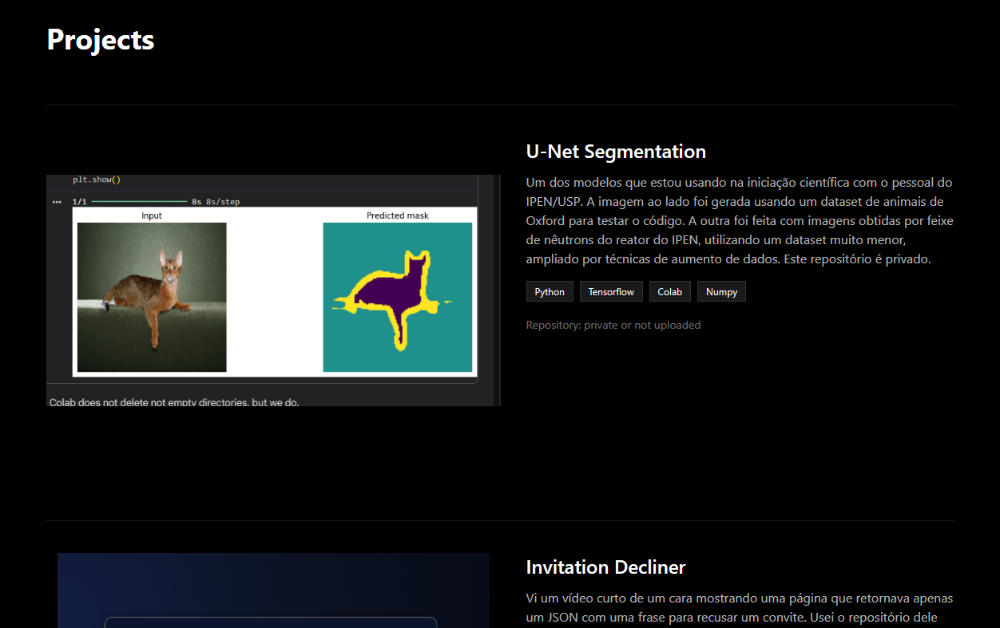
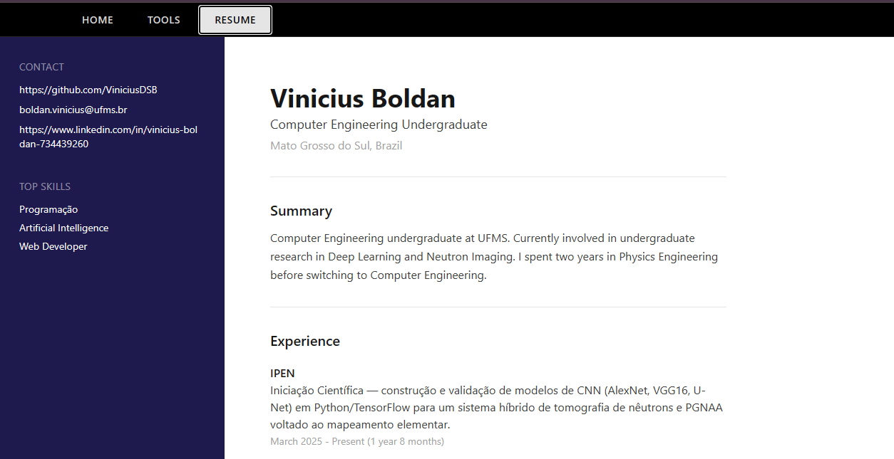

# O projeto

Portfólio pessoal desenvolvido para apresentar minha trajetória, habilidades e projetos em Engenharia da Computação, Inteligência Artificial e Desenvolvimento Web.

O projeto foi criado inicialmente para aprender React e utiliza Vite para executar o ambiente local. A maior parte da implementação foi construída com apoio de Inteligência Artificial, a partir de uma estrutura inicial planejada e descrita por mim até um certo nível de detalhe.



## Visão geral

O site possui três páginas principais:

| Página | Rota | Conteúdo |
| --- | --- | --- |
| Home | `/` | Apresentação visual em tela cheia e seleção de projetos em destaque |
| Projects | `/projects` | Catálogo detalhado dos projetos, descrições, imagens e tecnologias |
| Resume | `/resume` | Currículo formatado com perfil, resumo, experiências e formação |

O visual e a organização dos menus foram inspirados na identidade visual de interfaces de GTA V e GTA VI, combinando contrastes escuros, espaços amplos, tipografia em destaque e uma paleta de por do sol em Vice City e Preto.

## Páginas

### Home

A Home usa uma seção de *landing* em tela cheia como primeiro contato com o portfólio.

- Frases prontas são exibidas sobre a imagem de fundo.
- Quando o usuário volta ao topo depois de rolar a página, uma nova frase pode ser sorteada.
- Ao sair da tela inicial, uma interface sobreposta apresenta os projetos.
- Um projeto fica em evidência na área principal.
- Os projetos restantes aparecem em um carrossel lateral com scroll.
- Clicar em outro projeto aumenta sua relevância na área principal.
- O botão **See more** leva o usuário ao projeto correspondente na página Projects.

As frases estão preparadas para serem substituídas no futuro por uma API própria integrada a um modelo de linguagem (LLM), permitindo gerar apresentações de forma automática.



### Projects

A página Projects reúne uma visão detalhada de vários projetos pessoais, acadêmicos e profissionais.

Cada projeto pode apresentar:

- título e descrição curta ou completa;
- tecnologias utilizadas;
- imagens em carrossel;
- link para o repositório público;
- indicação de quando o repositório é privado ou ainda não foi publicado.

O projeto em destaque da Home pode ser aberto diretamente na seção correspondente da página Projects. Na página completa, os itens são exibidos em seções verticais com imagens, descrição, ferramentas e links.



### Resume

A página Resume apresenta o currículo em um formato visual limpo e inspirado no LinkedIn.

- perfil e título profissional;
- contatos;
- resumo profissional;
- principais habilidades;
- experiências;
- formação acadêmica;
- datas e duração das atividades.

A duração de experiências e períodos em andamento é calculada dinamicamente a partir das datas, evitando que o currículo fique desatualizado quando uma atividade continua em curso.



## Tecnologias

### Front-end

- React 19
- TypeScript
- Vite
- React Router
- Tailwind CSS
- HTML2PDF

### Estrutura

O repositório contém uma aplicação front-end separada do diretório auxiliar de back-end:

```text
portfolio/
├── frontfolio/        # Aplicação React
│   ├── public/
│   ├── src/
│   │   ├── content_data/
│   │   ├── other_components/
│   │   ├── views/
│   │   └── assets/
│   └── package.json
├── backfolio/         # Estrutura auxiliar do back-end
├── imgs_for_readme/   # Capturas usadas neste README
└── README.md
```

As informações dos projetos e do currículo estão centralizadas em arquivos TypeScript dentro de `frontfolio/src/content_data`, facilitando novas atualizações sem precisar modificar diretamente os componentes da interface.

## Execução local

Pré-requisitos:

- Node.js
- npm

Dentro da pasta do front-end:

```bash
cd frontfolio
npm install
npm run dev
```

O Vite iniciará o servidor local exibido no terminal, normalmente em `http://localhost:5173`.

Para gerar uma versão de produção:

```bash
npm run build
```

Para visualizar a versão de produção localmente:

```bash
npm run preview
```

## Projetos em destaque

Alguns dos projetos apresentados no portfólio incluem:

- U-Net para segmentação de imagens;
- classificadores VGG16 e AlexNet;
- sistemas de conversas e chat;
- TalkChat com Socket.IO;
- Metasup, uma extensão para Chrome integrada ao WhatsApp;
- automation para recusar convites;
- Tic Tac Toe para praticar React;
- sistemas web desenvolvidos em PHP, Vue, Node.js e Docker.

As descrições completas e as tecnologias de cada projeto podem ser encontradas na página Projects.

## Autor

**Vinicius Boldan**

- Engenharia da Computação — UFMS
- GitHub: https://github.com/ViniciusDSB
- LinkedIn: https://www.linkedin.com/in/vinicius-boldan-734439260
- Email: boldan.vinicius@ufms.br
